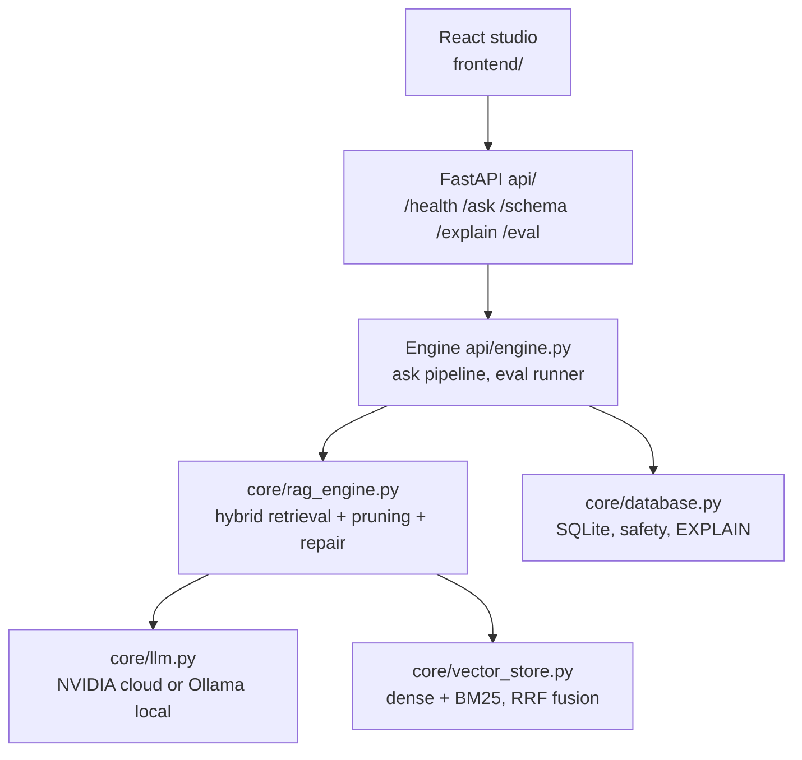
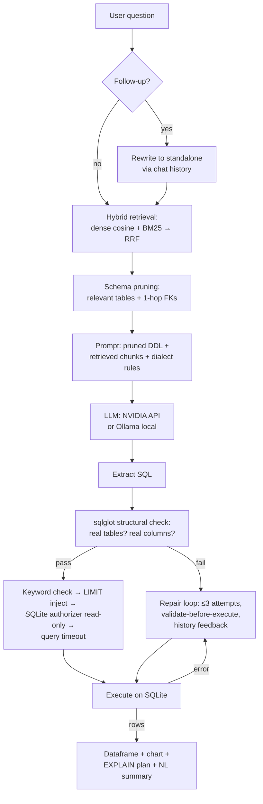

# SQL RAG Studio — Natural Language to SQL

A high-performance **Retrieval-Augmented Generation (RAG) SQL engine** with a
designed React studio on top: ask a plain-English question, get SQL you can
read, run, and trust — with hybrid semantic retrieval, schema pruning, and
layered safety guardrails over SQLite.

**Hosted demo:** https://sql-rag.129-80-41-146.nip.io/

Translate complex natural language questions into accurate, performant, and
safe SQLite queries with instant results, an EXPLAIN plan viewer, AI
auto-repair, and an execution-accuracy eval harness.

---

## Key features

- **React studio + FastAPI backend**: question composer, SQL code view with
  syntax highlighting, results table with CSV/JSON export, an SVG chart of
  the result set, schema explorer, EXPLAIN plan viewer, RAG diagnostics,
  query history, and a golden-eval runner — one container serves both.
- **LLM via NVIDIA API** (OpenAI-compatible, default model
  `nvidia/nemotron-3-ultra-550b-a55b`), configured purely from environment
  variables. Ollama stays available as a local option.
- **True hybrid retrieval**: dense cosine similarity **and** BM25 keyword
  search run independently, fused with **Reciprocal Rank Fusion (RRF)** —
  exact name matches and semantic matches reinforce each other.
- **Load-bearing schema pruning**: hybrid retrieval selects the relevant
  tables first (plus one-hop FK neighbors) and only those tables' DDL is
  injected into the prompt. This is what lets the engine scale past toy
  schemas to databases with hundreds of tables.
- **Persistent vector index**: the built index is cached on disk and reloaded
  when the DB file is unchanged (mtime check) — restarts skip re-embedding.
- **Layered safety guardrails**: keyword validation **plus** a SQLite
  authorizer callback that denies writes at the engine level, a
  progress-handler query timeout against runaway JOINs, and automatic `LIMIT`
  injection so the LLM can't dump a whole table.
- **Structural SQL validation (sqlglot)**: generated SQL is parsed and every
  table/column is checked against the real schema *before* execution —
  catches hallucinated names, the #1 text-to-SQL failure mode.
- **AI self-correction / auto-repair**: up to 3 repair attempts; each
  candidate is structurally validated before execution and prior failures
  feed back into the prompt so the model doesn't repeat mistakes.
- **Conversational follow-ups**: follow-up questions ("now only 2023") are
  rewritten into standalone questions against chat history.
- **Natural language summaries**: executive plain-English insights from
  query results.
- **Execution-accuracy evals**: a 30-question golden set scored by execution
  match (result sets, not SQL strings) — `python -m evals.run_evals`, or the
  Evals view in the studio.
- **Multi-source database management**: sample DB, custom SQLite upload, CSV
  ingestion, or a Faker-generated 17k-row `large_sample.db` for scale demos
  (`python scripts/generate_large_sample.py`).
- **In-place SQL editor** with per-query repair-attempt traces.

---

## Quick start

### Docker (recommended)

```bash
docker build -t sql-rag .
docker run --env-file .env -p 8000:8000 sql-rag
# open http://localhost:8000
```

The `.env` file needs one line: `NVIDIA_API_KEY=...` (see Configuration).
The sample database self-initializes on first start, so no volume is
required; mount `/app/data` to persist the DB and index cache.

### Local development

```bash
pip install -r requirements.txt
export NVIDIA_API_KEY=...          # or LLM_PROVIDER=ollama for local models

# backend (serves the API on :8000; builds the frontend if frontend/dist exists)
uvicorn api.main:app --reload --port 8000

# frontend dev server (in another terminal; proxies /api to :8000)
cd frontend && npm install && npm run dev   # http://localhost:5173
```

### Streamlit (local-only option)

The original Streamlit UI is still in the repo as `app.py` and still works
for local runs:

```bash
streamlit run app.py
```

It is not part of the hosted deployment.

---

## Configuration

All settings are environment variables. No keys live in code, and the API
never logs or returns key material.

| Variable | Default | Meaning |
|---|---|---|
| `NVIDIA_API_KEY` | — | **Required for the hosted demo.** NVIDIA API key. `LLM_API_KEY` and `AGENTROUTER_API_KEY` are accepted as aliases. |
| `LLM_PROVIDER` | `auto` | `auto` (cloud when a key is set, else Ollama), `cloud`, or `ollama`. |
| `LLM_BASE_URL` | `https://integrate.api.nvidia.com/v1` | OpenAI-compatible endpoint. Point elsewhere (e.g. AgentRouter `https://agentrouter.org/v1`) to use another provider. |
| `LLM_MODEL` | `nvidia/nemotron-3-ultra-550b-a55b` (cloud) / `llama3.1` (Ollama) | Model id for the selected provider. |
| `LLM_TIMEOUT_SECS` | `180` | Per-call LLM timeout. |
| `EMBEDDING_BACKEND` | `tfidf` | `tfidf` (offline, deterministic — the deploy default), `auto`, `ollama`, `sentence-transformers`. |
| `OLLAMA_HOST` | `http://127.0.0.1:11434` | Ollama server (read by the `ollama` client). |
| `SQLRAG_DB_PATH` | `data/sample.db` | SQLite database to query. |
| `SQLRAG_MAX_ROWS` | `500` | Row cap injected into every query. |
| `SQLRAG_QUERY_TIMEOUT_SECS` | `15` | Per-query execution timeout. |
| `PORT` / `HOST` | `8000` / `0.0.0.0` | API listen address. |

### NVIDIA reasoning-model note

The default model is a reasoning model: its thinking lands in a separate
`reasoning_content` field and consumes completion tokens *first*, so a small
`max_tokens` can return no content at all. The API layer therefore enforces
a generous cap on every cloud call (2048 by default, never below 1024 — see
`BoundedLLM` in `api/engine.py`), and reads the answer only from
`choices[0].message.content`. Reasoning content is ignored and never shown
in the UI. Temperature defaults to 0.2.

---

## API

The backend is FastAPI; interactive docs live at `/docs` when the server is
running. The frontend calls these endpoints same-origin.

| Endpoint | Method | Purpose |
|---|---|---|
| `/api/health` | GET | Status, DB tables, LLM provider/model/availability |
| `/api/config` | GET | Public settings (no key material) |
| `/api/schema` | GET | All tables with columns, row counts, foreign keys |
| `/api/schema/{table}` | GET | One table's details |
| `/api/ask` | POST | Ask a question → SQL + rows + summary + diagnostics |
| `/api/execute` | POST | Run edited SQL (same safety rules) |
| `/api/explain` | POST | `EXPLAIN QUERY PLAN` for a query |
| `/api/examples` | GET | Four starter questions |
| `/api/eval/questions` | GET | The golden question set |
| `/api/eval` | POST | Start an eval run (`{"mock": true}` needs no LLM) |
| `/api/eval/{run_id}` | GET | Poll an eval run |

---

## Architecture





---

## Sample database schema

The built-in sample database contains 4 interconnected enterprise tables
(auto-created by `core/database.py` on first run — the `.db` file itself is
gitignored and never shipped):
1. `departments`: id, name, budget, location, created_at
2. `employees`: id, name, department_id, role, salary, hire_date, city, email, performance_rating
3. `projects`: id, name, department_id, lead_id, budget, status, start_date, end_date
4. `sales_transactions`: id, employee_id, customer_name, product_category, amount, units_sold, transaction_date, region

Need scale? Generate a 17k-row version with the same schema:

```bash
python scripts/generate_large_sample.py          # -> data/large_sample.db
python scripts/generate_large_sample.py --employees 5000 --sales 50000 --db data/big.db
```

---

## Testing

```bash
# Unit + integration + API tests (e2e auto-skips if Ollama isn't running)
python -m pytest -v
```

---

## Evaluation (execution accuracy)

`evals/` holds a 30-question golden set over the sample DB. The metric is
**execution match**: the generated SQL scores iff it returns the same rows as
the golden answer (order-insensitive) — many different queries can be correct,
so comparing SQL strings would be dishonest.

```bash
python -m evals.run_evals --mock            # harness self-test, no LLM (expect 30/30)
python -m evals.run_evals --model llama3.1  # real run via Ollama
python -m evals.run_evals --provider cloud  # real run via cloud endpoint (needs key)
```

| Run | Score |
|---|---|
| Harness self-test (`--mock`) | 30/30 (100%) |
| llama3.1 via Ollama | run `python -m evals.run_evals` and fill in |

---

## How it scales

The retrieval is load-bearing, not decorative: the full schema is only dumped
into the prompt for small databases (≤5 tables). Beyond that, hybrid
dense+BM25 retrieval picks the relevant tables, expands one hop along foreign
keys so joins don't lose a table, and only that pruned DDL reaches the LLM.
The vector index persists to `data/index_cache/` and rebuilds only when the DB
file changes.

**Database-side: composite indexes for large tables.** The RAG layer can only
be as fast as the SQL it generates, so `scripts/import_imdb.py` (which builds
the multi-million-row IMDb stress DBs) creates targeted indexes alongside each
table. The motivating case: `principals` (~60M rows, cast & crew per title).
The query *"top actor by movie count"* filters `WHERE category = 'actor'` and
groups by `nconst` — with only the single-column indexes
(`idx_principals_nconst`, `idx_principals_category`) it blew past the 15s
query timeout. Adding the composite

```sql
CREATE INDEX idx_principals_cat_nconst ON principals(category, nconst);
```

fixed it: the equality column goes first, the grouped/joined column second, so
filter + group-by are served from one index (SQLite's leftmost-prefix rule —
`WHERE category = ?` can seek on the composite, and `nconst` is already
ordered within each category for the grouping). The takeaway for generated
SQL: index *query patterns*, not just columns — a composite on
`(filter_col, group_or_join_col)` beats two single-column indexes for the
filter-then-aggregate shape, because SQLite can typically use only one index
per table per query.

---

## License

MIT License. Free and open source.
